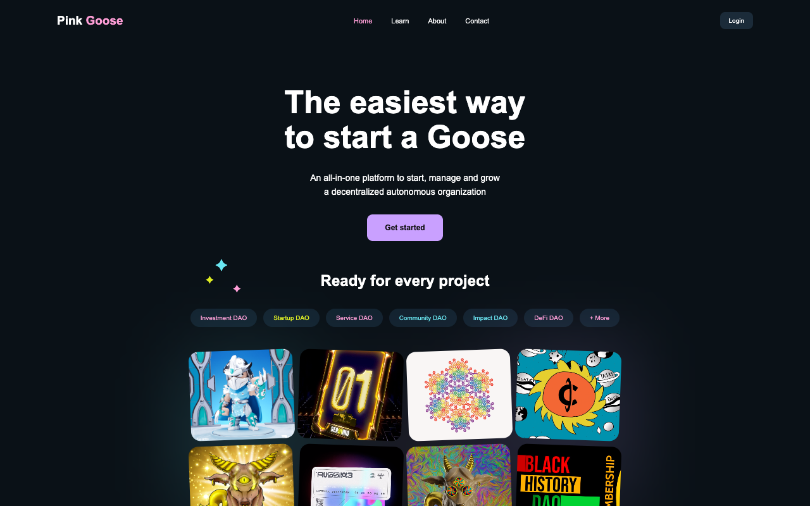
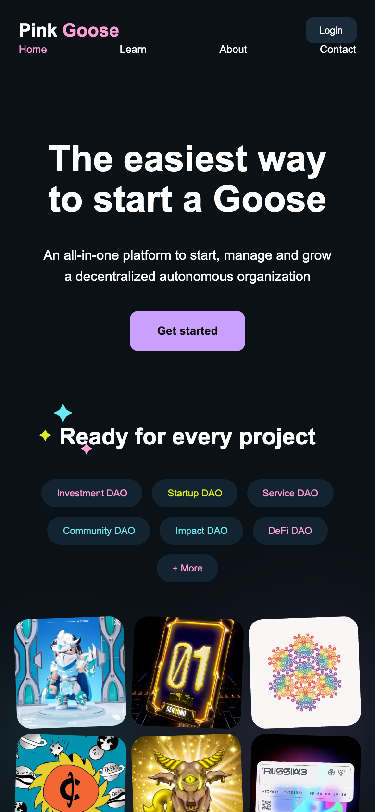

# Pink Goose

Een responsive website voor het fictieve bedrijf **Pink Goose**, gebouwd met alleen HTML en CSS. Ik heb dit gemaakt voor de module *Website 1 – Website lay-out en elementen* van mijn opleiding: het doel was om een aangeleverd Figma-ontwerp zo goed mogelijk 1-op-1 na te bouwen.

**Live bekijken:** https://stijnwtf.github.io/pink-goose/



## De opdracht

In de casus werk je als developer bij "Bedrijf X", dat een nieuwe website maakt voor de klant Pink Goose. De designer heeft het ontwerp al gemaakt; mijn taak was om dat om te zetten naar een werkende website. Daarbij lag de nadruk op:

- de indeling en kleuren precies volgens het ontwerp
- een goede HTML5-structuur (`header`, `nav`, `main`, `section`, `footer`)
- consistente CSS-classes en code conventies
- een nette mappenstructuur

## Pagina's

| Pagina | Inhoud |
|---|---|
| `index.html` | Homepagina met hero, projectgalerij, tools, support, nieuwsbrief, pers en podcasts |
| `learn.html` | Projecten, de "journey" en de tools waarmee Pink Goose werkt |
| `about.html` | Het team, de nieuwsbrief, pers en podcasts |
| `contact.html` | Contactknoppen en een formulier om je eigen goose te "posten" |

## Wat erin zit

- **Responsive:** werkt op desktop en mobiel, met één media query voor schermen tot 600px
- **Flexbox en grid** voor de lay-out van de navigatie, kaarten en galerij
- **Hover-effecten** op de galerij, kaarten en knoppen met `transform` en `transition`
- **Formulieren** met labels, `required`-velden en een eigen gestylede select
- **Toegankelijkheid:** alt-teksten, verborgen labels voor schermlezers en `aria-current` in de navigatie
- Iconen via [Font Awesome](https://fontawesome.com/)



## Mappenstructuur

```
pink-goose/
├── index.html
├── learn.html
├── about.html
├── contact.html
├── assets/
│   ├── css/
│   │   └── style.css
│   └── images/
└── docs/            screenshots voor deze README
```

## Lokaal openen

Geen installatie nodig. Clone de repo en open `index.html` in je browser:

```bash
git clone https://github.com/stijnwtf/pink-goose.git
cd pink-goose
open index.html
```

## Credits

Het ontwerp is aangeleverd door de opleiding als onderdeel van de casus. De inhoud (teksten, pers en podcasts) is gebaseerd op de website van Superdao en wordt hier alleen gebruikt als voorbeeldcontent voor een schoolproject.
